<!-- header:begin: brand-repos 0.1.0, variant studio, files in docs/brand/; the project-page sync drops this block -->
<picture>
  <source media="(prefers-color-scheme: dark)" srcset="docs/brand/readme-header-dark.svg">
  <source media="(prefers-color-scheme: light)" srcset="docs/brand/readme-header-light.svg">
  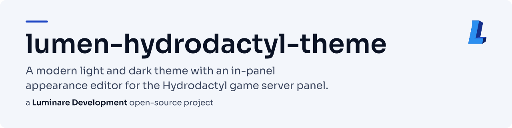
</picture>

<!-- byline:studio -->
*a [Luminare Development](https://luminare.tech/open-source/lumen-hydrodactyl-theme/) open-source project*
<!-- /byline:studio -->
<!-- byline:personal
*by Paul Pasaurek · [project page](https://luminare.tech/open-source/lumen-hydrodactyl-theme/)*
/byline:personal -->

<!-- header:end -->

# lumen-hydrodactyl-theme

A modern light and dark theme for the [Hydrodactyl](https://github.com/BlueprintFramework/hydrodactyl)
game server panel, for the client area and the admin area, with an **Appearance** page in the
admin panel that changes colours, fonts, spacing, layout and logos without a rebuild.

[](https://github.com/luminare-dev/lumen-hydrodactyl-theme/actions/workflows/ci.yml)
[](LICENSE)

| Dark | Light |
|---|---|
| 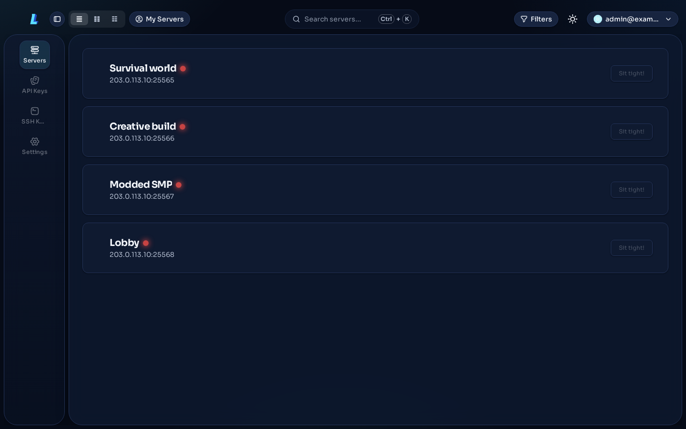 | 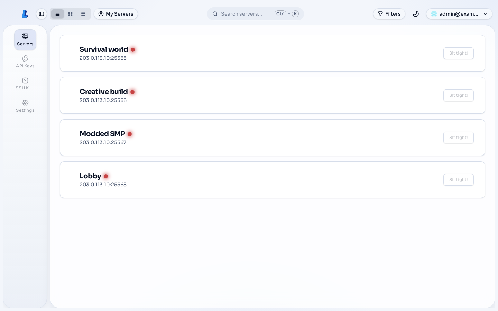 |
| 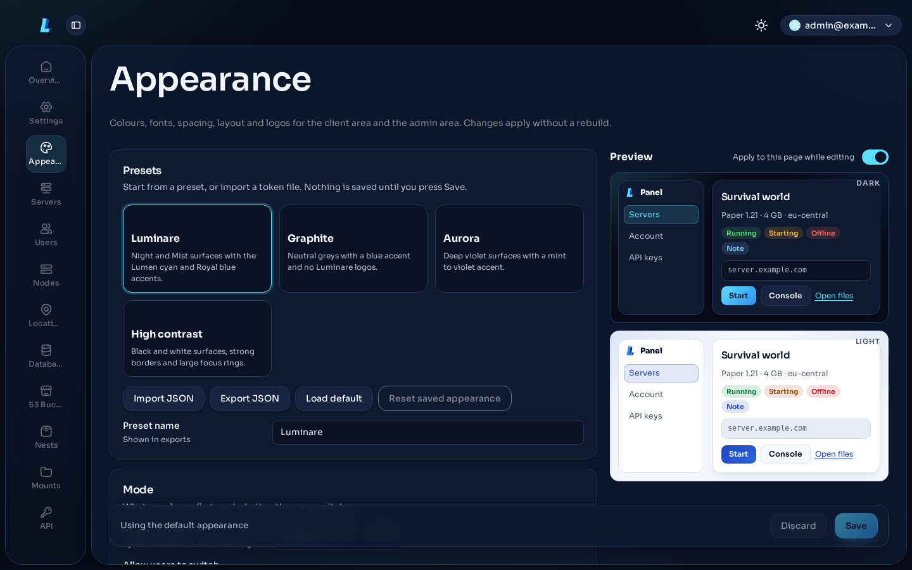 | 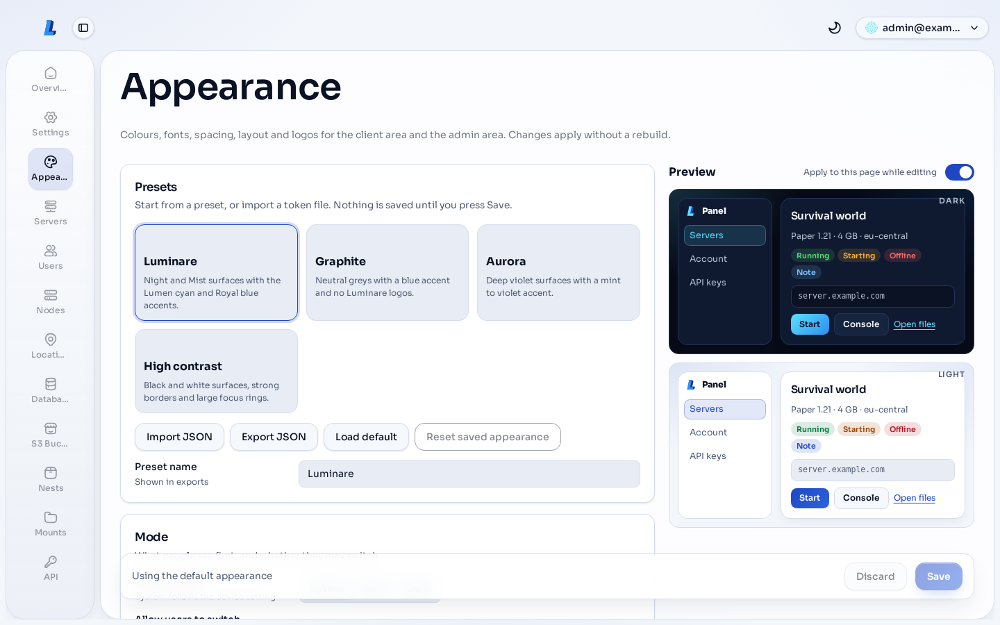 |
| 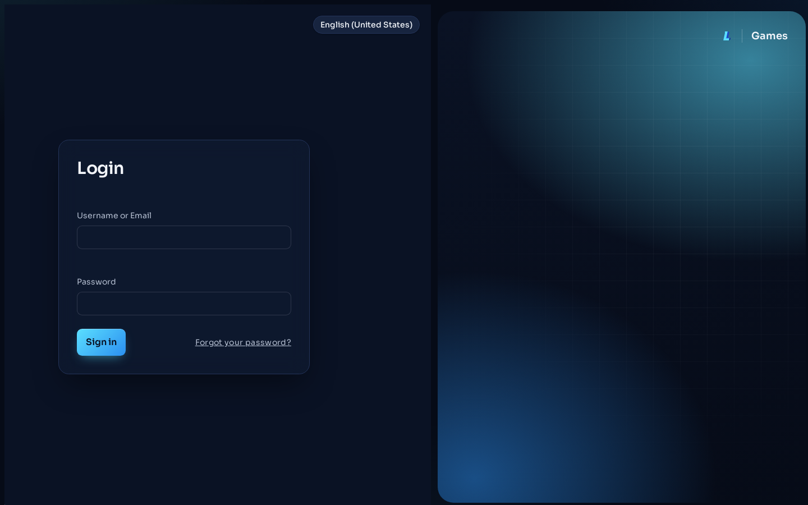 | 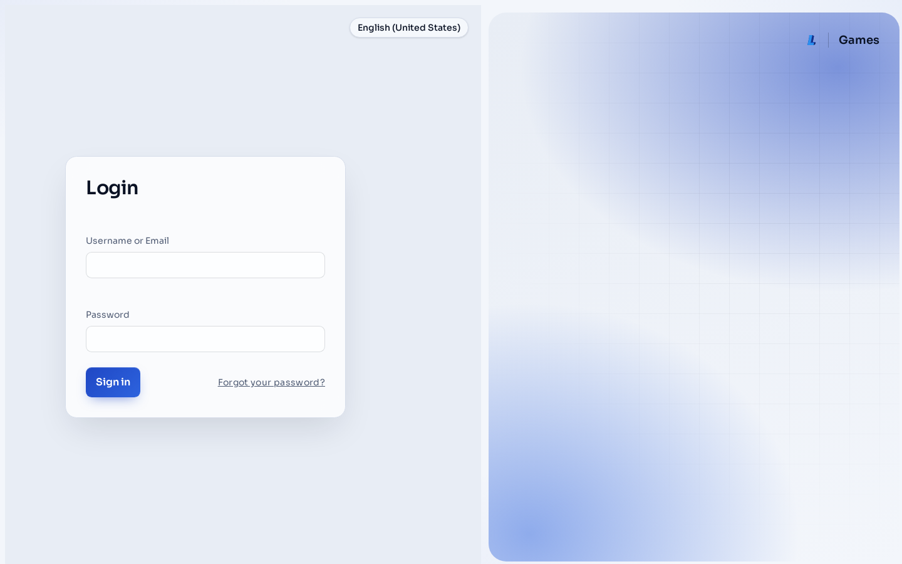 |
| 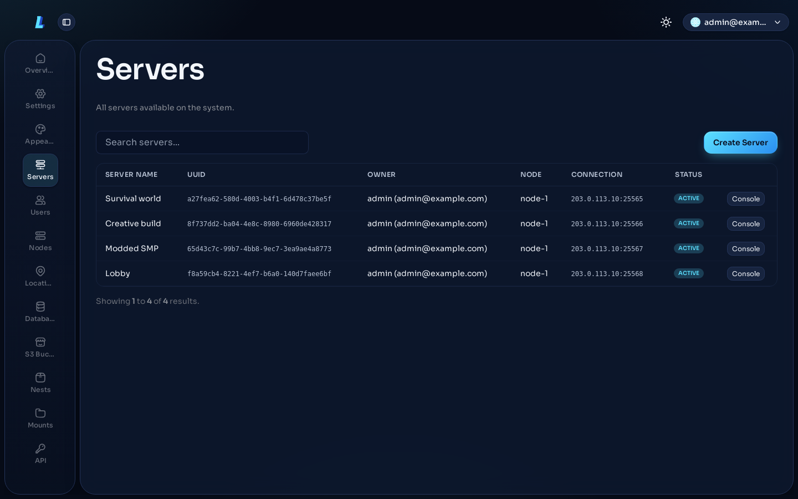 | 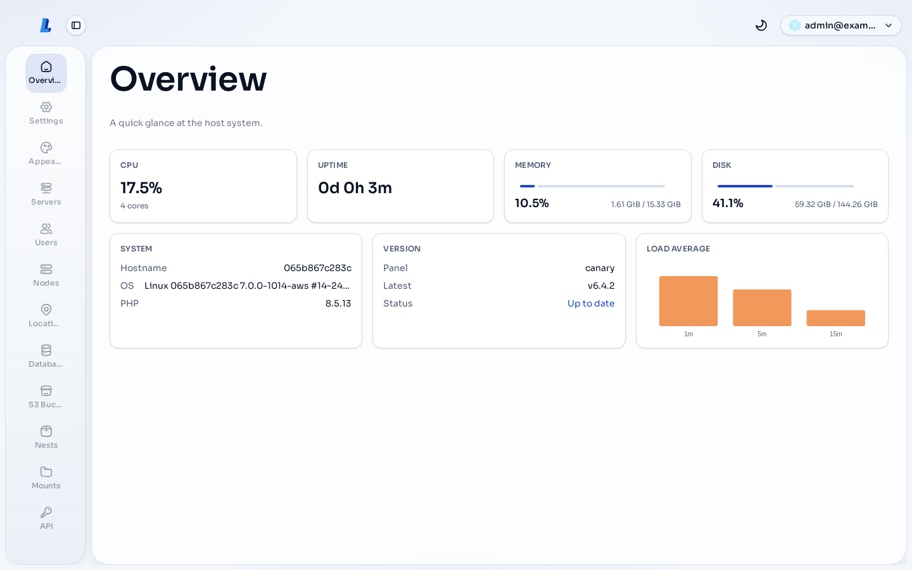 |
| 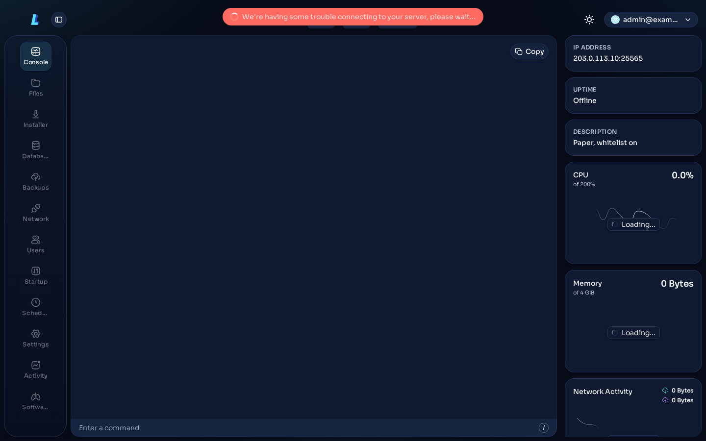 | 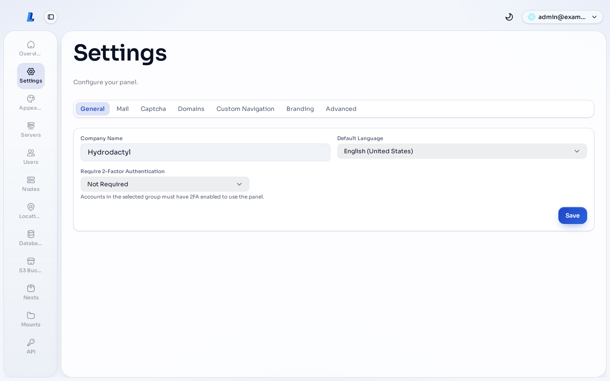 |

Screenshots from CI (the `screenshots` artifact of the `panel` workflow), with invented example data
and no daemon attached, so servers show as offline.

## Why

Hydrodactyl ships its own React client and admin panels and does not load Blueprint extensions,
so themes made for Pterodactyl do not work on it. Lumen is an overlay instead: a few new files and
five small patches applied to a Hydrodactyl checkout before the normal build. The look itself is
driven by a design-token file stored in the database, so admins restyle the panel in the browser.

## Features

- Lumen look for the client area, the React admin panel, the login pages and the server-rendered
  pages (error pages, and AdminLTE pages that some installs still have).
- Dark and light mode with a toggle; system default; the choice is remembered per user account.
- Admin → Appearance: presets, import/export JSON, live preview of the whole panel plus a
  side-by-side dark/light sample, per-mode colour pickers with WCAG contrast warnings, fonts, text
  size, radius, spacing, density, shadows, sidebar and layout switches, logo/favicon/login
  background uploads, custom CSS.
- One token schema ([docs/tokens.md](docs/tokens.md)) meant to drive the other Lumen themes too.
- Luminare branding by default, replaceable from the Appearance page.

## Quickstart

Back up the panel files and database first ([docs/install.md](docs/install.md)).

```bash
git clone https://github.com/luminare-dev/lumen-hydrodactyl-theme.git
lumen-hydrodactyl-theme/scripts/check-overlay.sh --panel /var/www/hydrodactyl
lumen-hydrodactyl-theme/scripts/install.sh --panel /var/www/hydrodactyl
```

Then open **Admin → Appearance**.

## How it works

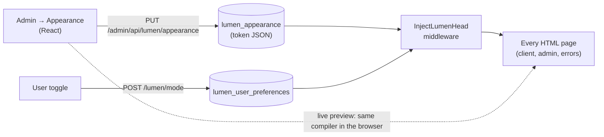

- `overlay/files/` holds the new files (Laravel service provider, controllers, middleware,
  migration, the token compiler in PHP and TypeScript, the Appearance page, `public/lumen/`).
- `overlay/patches/` holds the five patches: register the provider, persist the mode per user,
  logo slots, login artwork, and the Appearance entry in the admin navigation.
- A global middleware adds the Lumen head to every HTML response, so no Blade template is patched.
- The panel's Tailwind utilities read CSS variables, so the compiled tokens restyle every page.
  `lumen.css` adds the layout and component refinements on top.

## Supported versions

| Component | Tested with | Supported |
|---|---|---|
| Hydrodactyl | v6.4.2 (`fc93a1f`, `upstream.lock`) | v6.4.x; newer when `scripts/check-overlay.sh` passes |

CI applies the overlay to the pinned commit, builds the panel, runs Hydrodactyl's own checks and
the Lumen tests, boots it with MariaDB and Redis and takes screenshots. A weekly workflow checks
the overlay against Hydrodactyl's `main` branch and latest release.

## Limitations

- Hydrodactyl is a pre-release and changes fast; every update needs `uninstall.sh`, the update,
  then `install.sh` (the check tells you whether the patches still apply).
- The Appearance page is in English only.
- Some panel components hard-code colours; those keep their own look in both modes.

## Documentation

- [Installing, updating and removing](docs/install.md)
- [Customizing](docs/customize.md)
- [Token schema](docs/tokens.md)
- [Changelog](CHANGELOG.md)
- [Contributing](https://github.com/luminare-dev/.github/blob/main/CONTRIBUTING.md) ·
  [Security](https://github.com/luminare-dev/.github/blob/main/SECURITY.md)

## Not affiliated

Not affiliated with or endorsed by the Blueprint project or the Pterodactyl project. Hydrodactyl,
Blueprint and Pterodactyl are named only to describe what this project works with.

## Licence

[Apache-2.0](LICENSE). The patches change Hydrodactyl files (Apache-2.0, with Pterodactyl's MIT
notice in [third_party/LICENSE_PTERO.md](third_party/LICENSE_PTERO.md)); those keep their notices.
The licence covers the code only: the project name, the Luminare logos, header images and
`docs/brand/` are not licensed (see [NOTICE](NOTICE)).

<!-- byline:studio -->
*a [Luminare Development](https://luminare.tech/open-source/lumen-hydrodactyl-theme/) open-source project*
<!-- /byline:studio -->
<!-- byline:personal
*by Paul Pasaurek · [project page](https://luminare.tech/open-source/lumen-hydrodactyl-theme/)*
/byline:personal -->
